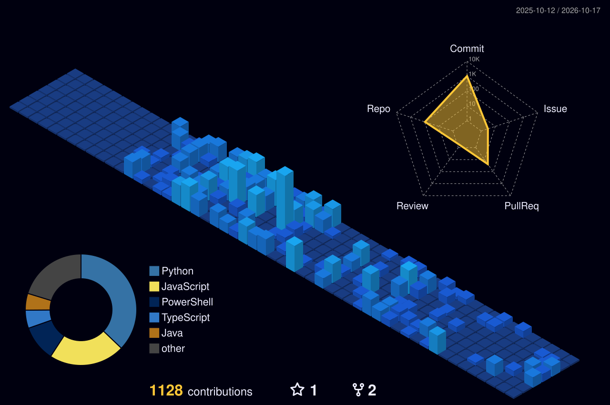

<div align="center">



</div>

⚡ The short version
I work on the boundary where software reliability meets physical hardware. On one side that's Kubernetes, CI/CD and observability. On the other it's ESP32 firmware, sensors and power systems. Both reward the same habits: design for failure, measure everything, automate the recovery.
```yaml
name: Vinod Ravindu Perera
roles: [Site Reliability Engineer, DevOps, Electrical & Electronic Engineer]
education:
  - BSc (Hons) Computer Science  # SLIIT
  - Electrical & Electronic Engineering  # SLTTC
focus: [multi-cluster Kubernetes failover, IoT telemetry, embedded firmware, supply-chain security]
open_source: [WSO2 Synapse, WSO2 API Manager]   # merged pull requests
community: IEEE PES Secretary
location: Colombo, Sri Lanka
principle: "Reliability is engineered, not hoped for."
```
---
☸️ Research spotlight: multi-cluster failover for IoT

My final-year research studies how IoT telemetry pipelines survive the loss of an entire Kubernetes cluster: health-check-driven routing, warm standby, automatic recovery, and what the failover actually costs in latency and data loss.
---
🧰 Toolbox
<div align="center">
Layer	Tools
Platform & SRE	    
CI/CD & Security	   
Observability	 
Embedded & IoT	    
Languages	     
</div>
Electronics: sensors · I²C / SPI / UART · ADC and signal conditioning · PCB fundamentals · power and energy systems
---
🔌 Featured projects
	Project	What it does
☸️	Multi-cluster K8s failover	Disaster recovery and automated failover across clusters serving IoT workloads
🏢	Occupancy-aware energy monitor	ESP32 system linking room occupancy to energy use, to cut waste
💧	ESP32 water monitor + ML leak alerts	Blynk dashboard with a machine-learning layer flagging abnormal flow
🤝	WSO2 contributions	Merged PRs to WSO2 Synapse and WSO2 API Manager
> 📌 Pin your six strongest repositories so they appear directly under this README.
---
🌆 My contributions in 3D
<div align="center">


</div>
---
📊 Stats
<div align="center">


</div>
---
🤝 Open to
DevOps, SRE, Cloud and Platform roles, and embedded / IoT engineering work where reliability, automation and hardware meet. Happy to talk Kubernetes reliability, incident response, IaC, ESP32 design, or open-source contribution.

<div align="center">
Reliability is engineered.

</div>
